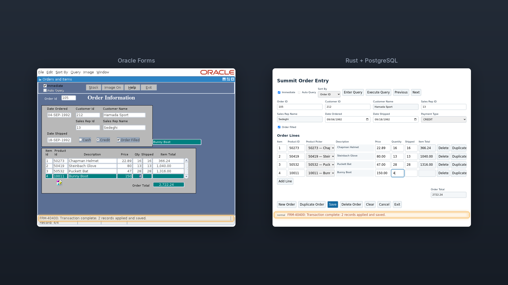

# Oracle Forms order entry, migrated to Rust and PostgreSQL

Oracle's Summit ORDERS order-entry form, running on Oracle Forms 14.1.2 and Oracle Database 23ai, was migrated by
Bosun's agent workflow to a Rust and PostgreSQL web application, and proved against the running original with Parity.

The same journey on both: 25 seconds. Click to play.

## Summary

<!-- port-specific, block 1 of 2 (port C). Swapping the port means rewriting only the two marked blocks. -->
- 89 % of user journeys behave exactly like the original, against 53 % for a coding agent alone (78.8 against 46.8
  of 89 journeys on average; strictest grading: screen, saved data and database conversation). This application:
  82 of 89 (92 %).
- On the original suite of 87 journeys: 91 % against 77 %; every one of the six Parity migrations scored above every
  one of the six by the coding agent alone. This application: 82 of 87 (94 %), the best of the six (port C in the
  dataset).
- Every Parity migration ships with its own proofs, passed under audit against the real Oracle Forms application;
  the coding agent's migrations ship with no audited proofs. This application's proofs are in `proofs/`.
- Journeys that saved wrong data: 1 in 522 with Parity, 13 in 522 without; none for this application. Where the
  cursor stands is not graded in these figures.
<!-- end of port-specific block 1 -->

## What Parity found in the finished applications

Each approach migrated the application six times.

**Proof that comes with the application.** Each of the six Parity migrations finished with its own proofs, 5 to 7
per application (73 to 110 steps), passing against the real Oracle Forms application under audit. The coding
agent's migrations came with no such proofs: two of the six kept their own comparison scripts against the
original, not audited and not part of any final check. Without proofs you only learn what works by testing the
finished application yourself.

The table shows how many of the six migrated applications had each defect.

| Defect | What goes wrong for a user | Coding agent alone | Bosun with Parity |
|---|---|---|---|
| Lost update | Two people edit the same order, and one person's change silently overwrites the other's. | 3 of the 6 applications | 1 of the 6 |
| Wrong data saved | The application saves something the original would not, for example an order with the same product on two lines, which the original refuses. | 4 of the 6 | 1 of the 6 |
| No lock while editing | The original locks an order the moment someone changes it. The migrated one does not, so two people can work on it at once without warning. | 5 of the 6 | none of the 5 checked |

The last row counts five of the Parity applications, because the sixth could not be checked for this (see the
dataset). This defect cannot be seen on screen or in the saved data: it shows only when the grader compares what
each system says to its database.

### How the Parity migrations avoided these

The difference is in the finished applications: the development records show that none of these three defects was
caught by a failing proof. The workflow's agents avoided them by observing the real legacy, through their proofs and
extra journeys they ran on it, and by carrying the legacy's constraints over from its source; in one application, a
comparison of the legacy with the application during the workflow exposed a missing lock and the agent fixed it.
Where a path was never run on the legacy, the defect stayed: one application each for the lost update and the wrong
data. The lock defect in the coding agent's applications is invisible on screen, because they imitate the lock in
memory; it was found only because the grader compared what each system says to its database.

### What the proofs did not cover yet

On five smaller behaviours, applications of both approaches still differ from the original, two of them more often
with Parity; none saved wrong data. As above, what the agents did not run on the legacy may not match: these are the
next proofs to write. For this application, see [Where it still differs](#where-it-still-differs).

## Legacy and migrated, side by side

The legacy is the real Oracle Forms client: a Java window with the order header, its lines, a toolbar, function
keys and modal dialogs. The migrated application is a web page with the same fields and buttons. Each row below is
covered by hidden journeys this application passes: the same actions on both sides gave the same screens, messages,
dialogs and committed rows.

| Function | What the user does | What both applications do |
|---|---|---|
| Find orders | Enter Query, type criteria (an order id, a customer, a date), Execute Query | Show the matching orders one at a time; "FRM-40301: Query caused no records to be retrieved. Re-enter." when none match; "FRM-40352: Last record of query retrieved." past the last one |
| Change an order | Type a new customer, ship date, payment type or Order Filled | Look up the customer and its sales rep when the cursor leaves the field; refuse an unknown customer ("Invalid Customer Id!"), a ship date before the order date ("Ship date is before order date!"), and credit for a customer who must pay cash (alert "This customer must pay cash!") |
| Change lines | Change a quantity or product, add a line | Recompute item and order totals; number a new line after the highest existing one, also after a gap |
| New order | New Order, customer, products typed or picked from the list, quantities, Save | Default the order date to today; refuse an unknown product ("Invalid Product Id!") and the same product twice on one order; commit the order, its lines and the line audit rows |
| Duplicate an order | Duplicate Order on a queried order, Save | A new order with the header and no lines |
| Delete | Delete a line or an order | Ask "Do you want to delete this line order?" or "Do you want to delete this order?"; refuse to delete an order that still has lines ("Cannot delete master record when matching detail records exist.") |
| Save | Save | "FRM-40400: Transaction complete: N records applied and saved." with the same N; "FRM-40401: No changes to save." when nothing changed |
| Unsaved changes | Clear, query or exit with changes pending | Ask "Do you want to save the changes you have made?" and act on Yes, No or Cancel; ask "Do you really want to leave the form?" on exit |
| Two users, one order | A second user changes or deletes an order the first is editing | Lock the order while the first user edits; the second gets "Could not reserve record (2 tries). Keep trying?"; a change to a row someone else changed first is refused ("FRM-40654: Record has been updated by another user. Re-query to see change.") |
| Options | Toggle Immediate and Auto Query, browse with Next and Previous | Fetch lines at once or when the cursor enters them, as Forms does |

## How we know it behaves the same

Parity runs the same user journey twice, once on the real Oracle Forms application and once on the migrated one,
and compares every screen, the rows each database committed, and what each application said to its database. It
records everything each side did under audit, so a difference cannot be hidden, and it gives no verdict on
incomplete evidence.

Two sets of journeys were run:

- **The agent's own proofs** (`proofs/`), written while it worked. They passed on both sides in the final check.
  `proofs/README.md` walks through one: query order 101, change its customer, leave the field, save. Both sides must
  show the old customer name while typing, the new one after leaving the field, and save one record.
- **A hidden suite** of 87 journeys (89 with the database conversation), written and frozen before any migration
  and never shown to the agent. It covers all 38 in-scope triggers and alerts of the form. The numbers at the top
  come from it.

<!-- port-specific, block 2 of 2 (port C) -->
## Where it still differs

Five of the 87 journeys differ, in three behaviours:

- **Cancel after changing a line's quantity** (2 journeys). Forms asks whether to save the changes (Yes, No,
  Cancel) and then clears the form. The migrated application refuses with "Function Not Allowed".
- **Lines of a new order entered before its customer** (1 journey). Forms says "FRM-40102: Record must be entered
  or deleted first."; the migrated application says "FRM-40202: Field must be entered.". Both refuse to save.
- **Duplicate Order on a new, unsaved order** (2 journeys), after its first line was duplicated. Forms keeps the
  cursor in the duplicated line and refuses with "FRM-40202: Field must be entered."; the migrated application asks
  whether to save the changes.

With the database conversation compared, two more journeys differ: when the user deletes an order that still has
lines, the migrated application locks the order row before refusing the deletion. Forms refuses without the lock.
The user sees the same refusal, but a second user is blocked from that order until the first moves on.

No journey committed different rows from Forms.

## How it was made

- Bosun's slices workflow, in its final configuration (in the dataset's `configs/`): survey the legacy, prove its behaviour with Parity,
  build the application, check it against the proofs, repair, and a final audited check. Model: GPT-6.1 Sol, with a
  smaller model for the workflow's own summaries.
- The agent had the form's source, the running legacy as a tool, and a task that states only the interface (build
  contract, UI test ids, table names). No business rules or messages were given.
- It wrote 6 proofs with 80 steps in total.
- 120 minutes in all: proving 31, building 56, checking against the proofs 26, final check 6. 4.05 credits.
- The application has no unit tests of its own; the comparison with the legacy was its behavioural check.
<!-- end of port-specific block 2 -->

## All three gradings

The same task, model and grading for both arms (six runs each; cursor not graded; mean and range):

| Grading | Bosun + Parity | Coding agent alone |
|---|---|---|
| 87 journeys: screen and committed rows | 78.8 of 87 (91 %), six ports, 77 to 82 | 66.7 of 87 (77 %), 58 to 72 |
| 89 journeys, without the database conversation | 79.5 of 89 (89 %), six ports, 77 to 84 | 67.0 of 89 (75 %), 58 to 72 |
| 89 journeys, with the database conversation compared | 78.8 of 89 (89 %), five ports, 75 to 82 | 46.8 of 89 (53 %), 37 to 56 |

One Parity migration (port E in the dataset) is left out of the last row because Parity could not read its start-up
database connection; that is a gap in Parity, not a difference in the port. Whether the cursor position is graded
was decided after the runs; with it graded the figures are lower for both arms and the gap is wider. The dataset
has every variant.

## Build and run

- **The migrated application:** `target/README.md`. Rust and PostgreSQL; it needs the Summit business rows, which
  you load yourself.
- **The legacy:** `legacy/README.md`, which links Oracle's download pages for [Oracle Forms](https://www.oracle.com/middleware/technologies/forms/downloads.html) and [Oracle Database Free](https://www.oracle.com/database/free/). You need your own Oracle downloads: the Forms 14.1.2 and Fusion Middleware
  Infrastructure installers, Oracle Database 23ai Free, and Oracle's Summit sample. From the sample, the build
  expects `ORDERS.fmb`, `m_summit.mmb`, `calendar.pll` and `Form_Builder_II.olb` in one directory
  that you pass to the build as the `forms-src` build context, and the schema export `init-summit.sql` loaded once into the database as user
  `summit`.
- **The proofs:** `proofs/README.md`. Running them needs both applications in the evaluation harness's audit container (Bosun's internal
  benchmark code, not published here).

## Links

- Results dataset: https://huggingface.co/datasets/bosun-ai/oracle-forms-migration

## License and third-party material

Our code, proofs and results here are licensed under the Apache License 2.0 (`LICENSE`, `NOTICE`). Oracle Forms,
Oracle Database and the Summit sample application are Oracle's; they are not included and not licensed here. Names
of Oracle products are used only to identify the legacy system. The video shows the Oracle Forms client running the
Summit sample only to identify and compare the legacy system.
